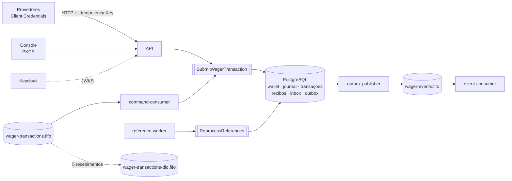

# Arquitetura

Este documento descreve as decisões, os trade-offs e as limitações da implementação entregue. A
fonte normativa é o [README do desafio](docs/research/challenge-readme.md). As decisões aprovadas
estão na [especificação](docs/spec.md) e nas [ADRs](docs/adr/). A rastreabilidade de cada
requisito até o código e os testes está na [matriz](docs/requirements-matrix.md).

## Visão geral

O sistema é um monólito modular NestJS em Bun 1.3.14 (TypeScript `strict`), com MikroORM 6.6 sobre
PostgreSQL 16.6 e SQS FIFO no LocalStack 4.0.3. API e workers são processos separados da mesma
imagem e compartilham o mesmo núcleo financeiro ([ADR 0016](docs/adr/0016-modular-monolith-mikroorm.md)).

| Módulo | Responsabilidade |
| --- | --- |
| `shared/domain` | `Money` (decimal.js), `IntegrationEvent` e `DomainError` |
| `modules/wallets` | `Wallet`, `JournalEntry`, abertura, ledger paginado e reconciliação |
| `modules/wagering` | `WagerPayload`, `WagerTransaction`, passos por tipo (`wager-step.ts`), recibos, eventos, caso de uso de submissão e reprocessamento de referências |
| `modules/identity` | Verificação de JWT do Keycloak e política de acesso de humanos e provedores |
| `modules/demo` | Cenários de demonstração e auditoria do ator humano |
| `messaging/*` | Consumidor de comandos, publisher da outbox, consumidor de eventos, runtime de workers e backoff |
| `observability` | Logger JSON sanitizado, métricas Prometheus, health |

O domínio não importa NestJS, MikroORM nem SQS. As classes de domínio têm construtor privado e
factories (`create`/`open`/`rehydrate`); `rehydrate` reconstrói estado persistido sem reexecutar
transições. Os casos de uso dependem das portas `WageringStore` e `WalletStore`, implementadas por
repositórios em `infrastructure/persistence`.

## Fluxo de uma operação financeira

HTTP e SQS montam o mesmo `WagerCommand` e chamam o mesmo `SubmitWagerTransaction`. O
`reference-worker` usa a mesma ordem de passos. Uma operação nova executa, em **uma** transação
PostgreSQL:

1. Leitura antecipada do recibo, sem lock: a mesma chave com o mesmo hash vira replay; com outro
   hash vira 409.
2. `SELECT … FOR UPDATE` da wallet. É o único lock de saldo, e é por wallet.
3. Nova checagem do recibo sob o lock e reserva da identidade, protegida por UNIQUE
   `(provider_id, idempotency_key)` e `(provider_id, external_transaction_id)`.
4. Resolução e validação da referência, quando houver.
5. Passo do tipo (`BET`, `WIN`, `LOSS`, `REFUND` ou `ROLLBACK`), que decide `PROCESSED`, `REJECTED`
   + `failureCode` ou `PENDING_REFERENCE`.
6. Gravação conjunta de transação no estado final, wallet (saldo e versão), linha do journal,
   recibo imutável, eventos na outbox, agenda de referência e, no SQS, a inbox.
7. Commit. Depois do commit vem a resposta HTTP ou o `DeleteMessage` do SQS. A publicação é
   assíncrona, pelo publisher.

Nenhuma chamada de rede acontece dentro da transação. Deadlock, falha de serialização e timeout de
lock geram até três tentativas dentro do prazo total (`FINANCIAL_DEADLINE_MS`). Uma violação das
UNIQUE de identidade faz rollback e uma nova tentativa, e a nova tentativa lê o vencedor como
replay ou conflito. Indisponibilidade retorna 503 e não consome a chave.

## Decisões e trade-offs

### ORM, Money e estratégia transacional (exigido pelo §4)

- **MikroORM**, a opção preferencial do desafio. Cada requisição ou trabalho usa
  `em.fork().transactional()`, com Unit of Work isolado e sem identity map compartilhado. As
  escritas financeiras usam SQL explícito pela conexão do MikroORM, e não entidades gerenciadas. O
  motivo é preservar `NUMERIC` como string, controlar a ordem dos locks e as constraints diferidas,
  e inserir o estado final decidido pelo domínio sem uma linha `PENDING` intermediária que nada
  acrescentaria. As migrations são do MikroORM, versionadas e reversíveis.
- **Money** é imutável, usa decimal.js (precisão 40) e aceita apenas strings com exatamente duas
  casas. São rejeitados NaN, Infinity, expoente, sinal, espaços e zeros à esquerda. O limite é
  `9999999999999999.99`. No banco, o valor fica em `NUMERIC` sem coerção de escala, no domínio
  `wagering.money_amount` (finito, escala ≤ 2, ≥ 0), e a moeda em coluna separada. Por isso
  `0.001` é recusado, e não arredondado ([ADR 0005](docs/adr/0005-exact-money.md)). O valor nunca
  passa por `number`.
- **Lock pessimista por wallet**, e não otimista com retry
  ([ADR 0004](docs/adr/0004-wallet-pessimistic-locking.md)). Sob disputa entre processos, as
  decisões de saldo ficam sequenciais por wallet, sem tempestade de retries. O custo é a vazão de
  uma wallet quente (~110–127 ops/s medidos; ver [carga](docs/evidence/issue-13/README.md)).
  Wallets diferentes não compartilham lock, e as contas de contrapartida são lidas sem lock.

### Garantias no schema

| Garantia | Mecanismo |
| --- | --- |
| Uma wallet por jogador e moeda | UNIQUE `(player_id, currency)` |
| Saldo nunca negativo | domínio `money_amount` (≥ 0) em `balance`, `balance_before` e `balance_after` |
| Sem débito ou crédito duplicado | UNIQUE de identidade, UNIQUE `journal.transaction_id`, UNIQUE `(wallet_id, wallet_version)` e índice único parcial `(referência, kind)` para reversões `PROCESSED` |
| Saldo = ledger | trigger diferido de cadeia: saldo e versão da wallet batem com o último lançamento, cada lançamento tem `before ± amount = after` e versões contíguas |
| Ledger imutável | triggers bloqueiam UPDATE, DELETE e TRUNCATE no journal, nas contas e nos recibos. O papel `jungle_runtime` não é dono das tabelas e tem só os grants por coluna necessários |
| Estados terminais | trigger de transição: `PENDING → PENDING_REFERENCE/PROCESSED/REJECTED/FAILED` e `PENDING_REFERENCE → PROCESSED/REJECTED/FAILED`. Campos financeiros são imutáveis depois do aceite |
| Atomicidade | outbox obrigatória para lançamentos e transações processadas (trigger diferido) e inbox com `transaction_id NOT NULL` |

O journal tem **partidas dobradas** em uma linha: conta debitada, conta creditada, valor positivo e
moeda única. Assim não existe meio par ([ADR 0012](docs/adr/0012-double-entry-ledger.md)). O ledger
da wallet (`wagering.wallet_ledger`) é uma view sobre esse journal. As contrapartidas de abertura e
de jogos são contas próprias, sem saldo materializado.

### Idempotência e recibos

- O escopo é o provedor: `(providerId, idempotencyKey)`
  ([ADR 0008](docs/adr/0008-provider-scoped-idempotency.md)). O header é obrigatório.
- `payloadHash` é o SHA-256 do JSON canônico, com chaves ordenadas recursivamente e sem espaços,
  dos campos `providerId`, `externalTransactionId`, `playerId`, `walletId`, `roundId`, `gameId`,
  `kind`, `money` e, quando presente, `referenceExternalTransactionId`. Chave, correlação,
  timestamps e IDs de transporte ficam de fora.
- Usar outra chave para a mesma operação externa retorna 409 `EXTERNAL_TRANSACTION_CONFLICT`
  ([ADR 0006](docs/adr/0006-external-operation-key-conflict.md)).
- O replay devolve **o recibo original**, com status HTTP e saldo observados no aceite, mudando
  apenas `idempotentReplay` ([ADR 0007](docs/adr/0007-stable-submission-receipt.md)). Um 202 continua
  202 mesmo depois da conclusão. Os GET mostram o estado atual.
- No SQS, a inbox `(consumer_name, message_id)` é gravada no fim da mesma transação. Um
  `messageId` repetido com outro conteúdo vai para a DLQ como `INBOX_CONFLICT`.

### Regras de negócio e interpretações

| Tipo | Efeito | Observação |
| --- | --- | --- |
| BET | débito | `INSUFFICIENT_FUNDS` se faltar saldo. Não aceita referência |
| WIN | crédito | Referência opcional; se informada, precisa ser uma BET processada compatível ([ADR 0017](docs/adr/0017-win-optional-reference.md)). O valor pode ser diferente do da BET |
| LOSS | nenhum | Registra o resultado e o evento `WagerTransactionProcessed`, sem ledger e sem versão nova |
| REFUND | crédito | Referencia BET processada, com valor igual |
| ROLLBACK | inverso da referência | BET, WIN ou REFUND. `REVERSAL_INSUFFICIENT_FUNDS` quando a reversão deixaria o saldo negativo |

- A referência precisa ter o mesmo provedor, jogador, wallet, moeda e rodada. Uma incompatibilidade
  conhecida é rejeitada na hora. Referência ausente ou pendente aguarda
  ([ADR 0010](docs/adr/0010-reference-state-policy.md)).
- A unicidade de reversão é por referência **e tipo**. REFUND e ROLLBACK da mesma BET são ambos
  aplicáveis (100 → 80 → 100 → 120). É uma leitura literal do §7, documentada e testada
  ([ADR 0009](docs/adr/0009-reversal-uniqueness-by-kind.md)).
- Valores zero são aceitos e geram o evento de resultado, mas não geram ledger, versão nova nem
  `WalletBalanceChanged`. Uma abertura zero não cria transação OPENING.
- `FAILED` existe no modelo e no schema, mas nenhum fluxo atual o produz. Indisponibilidade nunca
  vira falha financeira.

### Códigos de falha

São estáveis e servem para a máquina decidir o que fazer:

- Rejeições persistidas (422): `INSUFFICIENT_FUNDS`, `REVERSAL_INSUFFICIENT_FUNDS`,
  `AMOUNT_LIMIT_EXCEEDED`, `REFERENCE_REQUIRED`, `REFERENCE_KIND_MISMATCH`,
  `REFERENCE_CONTEXT_MISMATCH`, `REFERENCE_AMOUNT_MISMATCH`, `REFERENCE_NOT_PROCESSED`,
  `REFERENCE_NOT_FOUND`, `REFERENCE_NOT_READY` e `ALREADY_REVERSED`.
- Erros de transporte, que não persistem a operação: `INVALID_PAYLOAD` (400),
  `PLAYER_MISMATCH`/`CURRENCY_MISMATCH` (400), 401/403, `WALLET_NOT_FOUND` (404),
  `IDEMPOTENCY_CONFLICT`/`EXTERNAL_TRANSACTION_CONFLICT`/`WALLET_ALREADY_EXISTS` (409) e
  `INFRASTRUCTURE_UNAVAILABLE` (503).

O provedor pode repetir com a mesma chave depois de um 503. Os outros códigos são definitivos para
aquela chave ou pedem a correção do payload.

### Referências fora de ordem

O TTL é de 15 min desde o primeiro aceite. O backoff começa em 1 s, tem teto de 30 s e jitter de
50–100%. A agenda é persistida em `wagering.reference_retries`
([ADR 0011](docs/adr/0011-reference-wait-policy.md)). O worker seleciona candidatos sem manter lock,
obtém o lock da wallet e revalida tudo. Expiração, rejeição e evento são confirmados juntos.
Detalhes operacionais estão em [docs/operations.md](docs/operations.md).

### Mensageria

- **Entrada**: `wager-transactions.fifo` com `MessageGroupId = walletId`. A deduplicação FIFO é
  apenas uma otimização; os testes variam o ID de transporte para que as duplicatas cheguem à
  aplicação. O ack acontece depois do commit. Negócio recebe ack; erro transitório não recebe ack e
  entra em backoff; erro permanente ou conflito de contrato vai para a DLQ com diagnóstico.
  `maxReceiveCount` é 5. No SIGTERM, o consumidor drena, cancela e só então devolve a visibilidade
  ([ADR 0014](docs/adr/0014-sqs-consumer-failures.md)).
- **Outbox**: os eventos são gravados na transação financeira com uma sequência por wallet,
  independente de `wallet.version`, porque LOSS e rejeições também geram eventos. O publisher
  reserva com `SKIP LOCKED`, usa lease e token persistidos e só confirma se ainda for o dono da
  lease. Publicar duas vezes é seguro: o `eventId` é estável, o consumidor tem inbox e a projeção
  não regride ([ADR 0013](docs/adr/0013-outbox-persistent-leases.md)). Não há promessa de
  exactly-once no transporte.
- **Eventos**: `WagerTransactionProcessed` (inclusive LOSS), `WagerTransactionRejected`,
  `WalletBalanceChanged` (só quando o saldo muda) e `WagerTransactionPendingReference`. São
  subclasses de `IntegrationEvent` com `eventType` e `version` no tipo. O envelope `toJSON()` segue
  o §11 e `data` usa `MoneyProps`.

### Identidade

Keycloak é o IdP externo. O console usa Authorization Code + PKCE S256 e guarda os tokens em
memória. Os provedores usam Client Credentials, e cada cliente fica vinculado a um `providerId` por
`PROVIDER_CLIENTS`. A API verifica a assinatura RS256, o issuer, a audience `jungle-api`, a
expiração e os perfis. Um `providerId` diferente do token retorna 403. Os cenários do console obtêm
o token de provedor no servidor e passam pelo mesmo endpoint HTTP dos provedores, registrando o
ator humano em `demo.scenario_audit`.

O Keycloak publica um issuer fixo (`KC_HOSTNAME`) e atende os containers pelo backchannel. Assim,
o token que a API obtém pela URL interna tem o mesmo `iss` que a API valida.

### Observabilidade

Os logs são JSON, com `correlationId`, `messageId`, `transactionId`, `walletId` e `providerId`, e
mascaram credenciais, payloads e valores. As métricas Prometheus cobrem:

- transações por status (contagem durável vinda do banco);
- tentativas, duplicatas, retries por componente e motivo;
- transferências e profundidade da DLQ;
- conflitos de lock;
- latência;
- outbox pendente, bloqueada e a idade do evento mais antigo;
- referências pendentes;
- divergências de reconciliação.

Os labels têm cardinalidade limitada. O dashboard Grafana é provisionado. Detalhes estão em
[docs/observability.md](docs/observability.md).

## Desvios de forma em relação aos esqueletos do README

O §6 permite adaptar nomes e assinaturas desde que as garantias se mantenham. As adaptações são:

- `Money.create(amount, currency)` no lugar de `Money.from(props)`. `Wallet.open` retorna a wallet
  e, se houver abertura, a transação OPENING, o lançamento e o evento como um só resultado.
- O ledger da wallet é derivado de `JournalEntry` (par débito/crédito) e não de uma classe
  `WalletLedgerEntry` própria, por causa das partidas dobradas.
- Inbox e outbox são registros de persistência com políticas puras
  (`messaging/outbox/publication-policy.ts`, `worker-backoff.ts`), e não as classes de domínio
  `InboxMessage`/`OutboxMessage`. As garantias de unicidade, atomicidade, lease e backoff estão no
  schema e no repositório.
- `IntegrationEvent` recebe o contexto (`correlationId`/`causationId`) e o `occurredAt` serializado,
  em vez de `IntegrationEventProps`. O envelope `toJSON()` é o do §11.
  `WalletBalanceChanged.from(entry, occurredAt, ctx)` usa o lançamento, que já carrega saldo antes e
  depois e a versão.
- A matriz de tipos de referência permitidos (REFUND → BET; ROLLBACK → BET/WIN/REFUND) é validada
  no domínio. O banco valida contexto, valor, direção do ROLLBACK e unicidade da reversão, que são
  as garantias exigidas no schema pelo §5.9.

## Limitações conhecidas

- **Vazão da outbox.** É o principal limite medido. O publisher reserva só o evento cabeça de cada
  wallet por ciclo, para preservar a ordem por agregado. Por isso uma wallet quente publica poucos
  eventos por segundo, e sob carga sustentada a outbox não drenou nos 30 s seguintes. O caminho
  financeiro não é afetado: as respostas não esperam a publicação e as invariantes passaram. O
  sleep após lote cheio foi removido no PR #28. Reservar cadeias por agregado muda a ADR 0013 e
  está na [issue #27](https://github.com/RafaelAugustoR/jungle-gaming-challenge/issues/27), fora
  desta entrega.
- **Wallet quente.** O lock por wallet serializa a wallet: ~110–127 ops/s neste host, e mais
  instâncias não aumentam esse teto. Com 3 APIs em wallets distribuídas, as 500 ops/s oferecidas
  foram sustentadas; o teto com 3 APIs não foi medido.
- **Medições de carga.** Foram feitas em um host único compartilhado (WSL2), com gerador no mesmo
  host, só entrada HTTP e pool de 5 conexões. São ordem de grandeza, não previsão de produção
  ([docs/load-testing.md](docs/load-testing.md)).
- **SQS emulado.** O LocalStack 4.0.3 foi validado para FIFO, deduplicação, visibilidade e redrive.
  Isso não prova equivalência com a AWS em todos os detalhes. A demo hospedada também usa o
  LocalStack, só na rede interna.
- **Um papel de runtime.** API e workers usam o mesmo papel restrito `jungle_runtime`. Separar
  logins por processo fica como endurecimento posterior.
- **Sem expurgo.** Inbox, outbox, recibos e agenda de referências não são expurgados.
  Idempotência sem expiração foi uma decisão desta entrega.
- **FAILED.** O estado está modelado, mas nenhum fluxo o produz. Erros permanentes de transporte
  vão para a DLQ sem criar transação.
- **Escopo.** Ficam fora pagamentos reais, conversão cambial, reversões parciais, OpenTelemetry e
  multi-tenancy (ver [Out of Scope](docs/spec.md#out-of-scope)).

## Referências

[Especificação](docs/spec.md) · [ADRs](docs/adr/) · [Matriz](docs/requirements-matrix.md) ·
[Testes](docs/testing-strategy.md) · [Operação](docs/operations.md) ·
[NestJS + MikroORM](https://docs.nestjs.com/recipes/mikroorm) ·
[MikroORM identity map](https://mikro-orm.io/docs/identity-map) ·
[PostgreSQL explicit locking](https://www.postgresql.org/docs/current/explicit-locking.html) ·
[Keycloak hostname](https://www.keycloak.org/server/hostname)
